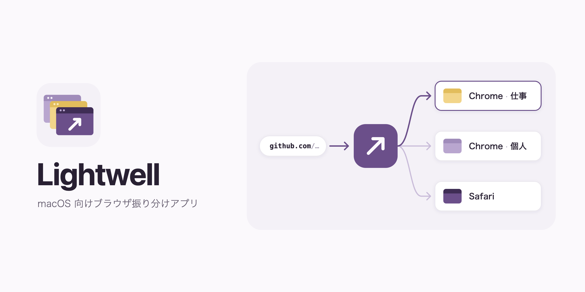

# Lightwell



macOS のデフォルトブラウザとして登録し、開かれたリンクを条件に応じて各ブラウザ (Chromium 系はプロファイル単位) に振り分ける常駐アプリ。

- URL のホスト / URL パターン、リンクを開いたアプリでルールを書ける
- Fn キーを押しながら開くと、ルールより優先して Alternative に設定したブラウザで開く
- ルールで行き先が決まらないときや、ルールで指定したときはカーソル位置に選択 UI を出す。並べるブラウザと順番は設定できる
- 常駐して App Nap を無効化し、行き先が決まっているリンクは UI を経由せずに即座に開く

## インストール

```sh
./scripts/bundle.sh --install   # ~/Applications/Lightwell.app に配置して起動
```

メニューバーのアイコン →「デフォルトブラウザに設定」で登録する。リンクを開くたびに起動待ちが発生しないよう、設定画面の「ログイン時に起動」を有効にしておくこと。初回起動時は設定画面が自動で開く。

アイコンは `resources/*.svg` を編集し、`./scripts/icons.sh` で `AppIcon.icns` と `MenuBarIcon.tiff` を再生成する。README の画像は `resources/Hero.svg` を編集し、`./scripts/hero.sh` (Google Chrome が必要) で `Hero.png` を再生成する。

## 設定

`~/.config/lightwell/config.toml` (`$XDG_CONFIG_HOME` を優先)。メニューバー →「設定…」の GUI からも編集できる。ファイルの変更はリンクを受け取るたびに検知されるので再起動は不要。GUI で保存するとコメントは消える。

```toml
[default]            # どのルールにもマッチしなかったとき
type = "picker"

[alternative]        # Fn キーを押しながら開いたとき (ルールより優先)
type = "browser"
bundle_id = "com.apple.Safari"

[[picker_items]]     # 選択 UI に並べるブラウザと順番。省略すると検出したものをすべて表示
bundle_id = "com.google.Chrome"
profile = "Profile 1"   # 省略すると、最後に使ったプロファイルで開く

[[picker_items]]       # picker_items に書いていないものは表示しない
bundle_id = "com.apple.Safari"

[[rules]]            # 上から順に評価し、最初にマッチしたものを使う
name = "仕事"
hosts = ["*.slack.com", "github.com"]        # * のみ使えるglob。*.example.com は example.com 自体にはマッチしない
urls = ["https://docs.google.com/*"]         # URL 全体に対するglob
source_apps = ["com.tinyspeck.slackmacgap"]  # 開き元アプリのバンドルID
[rules.action]
type = "browser"
bundle_id = "com.google.Chrome"
profile = "Profile 1"   # ~/Library/Application Support/Google/Chrome 配下のディレクトリ名
```

1 つのルール内の条件はすべて満たす必要があり、省略した条件は「何でもよい」扱いになる。条件が 1 つもないルールは何にもマッチしない。

選択 UI では数字キー・矢印キーと Enter・クリックで選択し、Esc かフォーカスを外すとキャンセルする。設定画面での変更は自動で保存される。

## 開発

```sh
cargo test
cargo run      # 未バンドルで起動。URL の受け取りを試すには bundle.sh で .app にする必要がある

# 見た目の確認 (デバッグビルドのみ)。起動直後に表示し、screencapture -l に渡すウィンドウ番号を出力する
LIGHTWELL_PREVIEW=picker cargo run                 # settings / settings:picker / settings:rules / settings:rule も可
```
